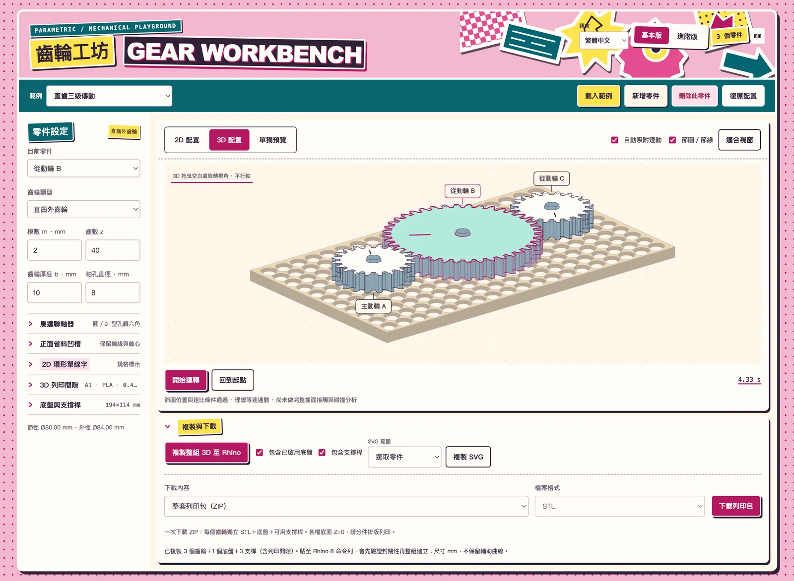
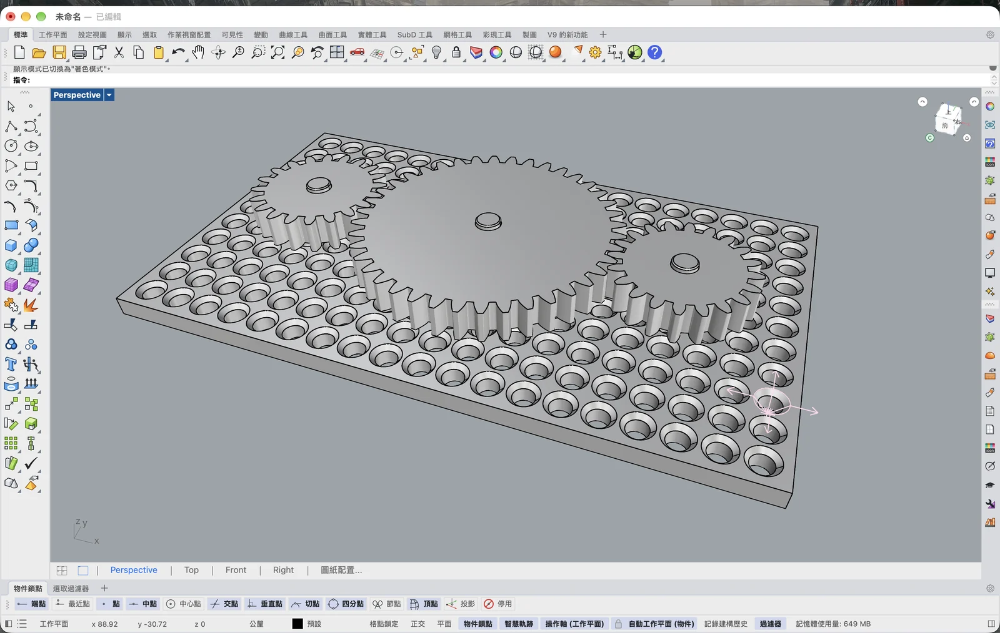
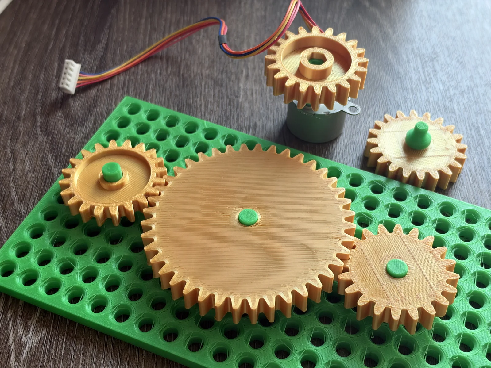

# 齒輪工坊 · Gear Workbench

[繁體中文](#繁體中文) · [English](#english)

## 繁體中文

[開啟網頁使用](https://zionw.github.io/gear-workbench/)

在瀏覽器中建立齒輪、配置傳動與預覽 2D／3D 模型，並複製至 Rhino 或下載加工、列印檔案。所有計算在瀏覽器進行，尺寸單位為 mm。

> **AI 生成與測試聲明**
>
> 本專案的網頁程式、介面、齒輪／底板／聯軸器生成邏輯及說明皆由 AI 生成，並依使用者回饋調整；第三方 Earcut 程式依原授權使用。
>
> **除下圖所示的部分操作與實體列印紀錄外，其他功能尚未經實際測試。** 圖片不代表所有齒輪類型、尺寸、匯出格式、列印間隙或組裝方式均已驗證。自動化程式檢查也不等同實際製造、負載與耐用性測試。使用前請自行確認尺寸、材料與配合，先製作試件。
>
> 以下截圖與照片由使用者提供，並非 AI 合成圖片。

## 使用畫面與列印紀錄

### 網頁介面



### Rhino 模型



### 實體列印



三張圖片皆經等比例縮小及 WebP 壓縮，保留畫面與零件細節；未上傳原始大圖。

## 功能

- 直齒、斜齒、內齒輪、齒條，以及多零件配置與理想連動模擬。
- 基本／進階設定、四語介面（繁中、英文、日文、韓文）。
- 2D／3D 配置與單獨元件預覽，顯示主要尺寸。
- 齒輪標籤、標註引線、環形單線雕刻資訊與輕量互動效果。
- 規則洞洞底板、可拔插支撐桿，以及自適應底板與融合固定支撐桿。
- 圓形、D 型、雙 D 馬達軸孔與聯軸器，厚度、凹槽及列印間隙設定。
- SVG 複製、STL／STEP／DXF 下載、整套列印 ZIP，以及 Rhino 8 整組 3D 複製命令。

以上為程式提供的功能清單，不表示每項功能均已完成實際測試。

## 操作

1. 載入範例或新增零件，在左側調整尺寸與齒形。
2. 在 2D 拖近相容齒輪，出現黃色外框後放開即可吸附連動。規則洞洞底板啟用時，同時檢查孔位；孔距與中心距不相容時會提示調整。
3. 開始運轉檢查理想連動，切至 3D 或單獨預覽查看形狀與尺寸。
4. 在「複製與下載」選擇輸出內容。Rhino 命令貼至 Rhino 8 命令列；列印包分件輸出，各件底面 Z=0。

## 底板與裝配

規則底板採沉槽孔位與可拔插桿件。自適應底板依配置收邊，只在聯軸器接軸處保留轉動孔；普通外齒輪的支撐桿與底板融合，桿件固定，齒輪套在桿上轉動。內齒輪與齒條仍需另製支撐或滑軌。

自適應底板與固定桿以同一件 STL 輸出，Rhino 複製亦融合為同一實體。其孔軸總直徑差至少 0.4 mm、齒輪下方留 0.2 mm 軸向空隙，作為 A1／PLA／0.4 mm 噴嘴的試印起點，並非精度或可動性保證。可依試件加大間隙，避免在切片器重複補償。

聯軸器接底板採一體軸。程式會增大齒輪六角孔對邊，使下方圓柱可穿過；若超過齒根可用範圍，需調整齒輪尺寸。接底板時馬達孔下端保留底厚，馬達本體需另行固定。馬達孔配合請先使用軸試配包確認。

## 使用限制

模擬為固定輪心、平行軸的理想運動學，未計算負載、摩擦、彈性與完整齒面接觸。齒形採平滑近似。列印結果會受材料、方向、切片設定及設備誤差影響，請自行驗證後使用。

## 本機執行與程式結構

無建置步驟。在專案目錄執行：

```sh
python3 -m http.server 52779 --bind 127.0.0.1
```

開啟 `http://127.0.0.1:52779/`。程式測試使用 Node.js 20 以上執行 `npm test`。

`engine.js`：齒形與連動；`coupler.js`：聯軸器；`mount.js`：底板與支撐桿；`exports.js`：幾何匯出與 Rhino 命令；`downloads.js`：下載與 ZIP；`app.js`：配置互動；`component-preview.js`：單件檢視；`annotations.js`：標籤；`motion.js`：顯示特效；`i18n.js`／`translations.js`：語系。

含孔面的三角化使用 Earcut 2.2.4，授權見 [earcut-LICENSE](assets/vendor/earcut-LICENSE)。

---

## English

[Open Gear Workbench](https://zionw.github.io/gear-workbench/)

Create gears, arrange gear trains, and preview 2D/3D models in your browser. Copy models into Rhino or download files for fabrication and 3D printing. All calculations run in the browser. Dimensions are in millimeters.

> **AI-generated content and testing disclosure**
>
> The web application code, interface, gear/baseplate/coupler generation logic, and documentation were generated by AI and refined through user feedback. The third-party Earcut library is used under its original license.
>
> **Other than the limited operations and physical prints documented in the images below, the remaining features have not been tested in practice.** These images do not establish that every gear type, dimension, export format, print clearance, or assembly method has been validated. Automated software checks are not a substitute for fabrication, load, or durability testing. Check dimensions, materials, and fit yourself, and make test pieces before use.
>
> The screenshots and photographs were supplied by the user; they are not AI-generated images.

### Interface and physical print examples

**Web interface**


**Rhino model**


**Physical prints**


All three images were proportionally resized and compressed to WebP while retaining interface and part details. The original full-size images are not included in the repository.

### Features

- Spur gears, helical gears, internal gears, racks, multi-part layouts, and idealized motion simulation.
- Basic and advanced controls, with Traditional Chinese, English, Japanese, and Korean interfaces.
- 2D/3D assembly views and individual component inspection with key dimensions.
- Gear name tags, leader lines, circular single-line engraving information, and subtle interaction effects.
- Regular pegboards with removable posts, and adaptive baseplates with integrated fixed posts.
- Round, D-shaped, and double-D motor shaft sockets and couplers, with adjustable thickness, recesses, and print clearances.
- SVG copying, STL/STEP/DXF downloads, a ZIP print kit, and commands to copy the complete 3D assembly into Rhino 8.

This list describes the available software features; it does not mean each feature has been physically tested.

### How to use

1. Load an example or add parts, then adjust dimensions and gear geometry in the left panel.
2. Move compatible gears closer in the 2D view. Release when the yellow outline appears to snap and connect them. With a regular pegboard enabled, snapping also checks hole alignment. Incompatible hole spacing and gear center distances require adjustment.
3. Start the simulation to inspect idealized motion. Switch to 3D or individual component inspection to examine shapes and dimensions.
4. Select the output in **Copy and download**. Paste the Rhino command into the Rhino 8 command line. The print kit exports separate parts, each with its bottom at Z=0.

### Baseplates and assembly

The regular pegboard uses recessed holes and removable posts. The adaptive baseplate follows the current layout and retains rotation holes only where a coupler connects to the baseplate. Support posts for ordinary external gears are fused to the baseplate: the posts stay fixed while the gears rotate around them. Internal gears and racks still require separate supports or guides.

The adaptive baseplate and fixed posts export as one STL part and are also fused into one solid when copied into Rhino. The total bore-to-shaft diameter difference is at least 0.4 mm, with a 0.2 mm axial gap below each gear. These are starting values for test printing on a Bambu Lab A1 with PLA and a 0.4 mm nozzle, not guarantees of accuracy or free movement. Increase clearances based on test pieces, and avoid applying the same compensation again in the slicer.

A coupler connected to the baseplate uses an integral shaft. The application increases the gear's hexagonal bore across flats so the lower cylindrical section can pass through it. If this exceeds the space available inside the tooth roots, adjust the gear dimensions. In this mode, material is retained at the bottom of the motor socket, and the motor body needs a separate mount. Use the shaft-fit sample kit to check the motor socket fit first.

### Limitations

The simulation models idealized kinematics with fixed gear centers and parallel axes. It does not calculate load, friction, elasticity, or full tooth contact. Tooth profiles use smooth approximations. Printed results depend on material, orientation, slicer settings, and machine tolerances; verify them before use.

### Running locally and code structure

No build step is required. Run this command from the project directory:

```sh
python3 -m http.server 52779 --bind 127.0.0.1
```

Open `http://127.0.0.1:52779/`. To run the software tests, use Node.js 20 or later and execute `npm test`.

- `engine.js`: gear geometry and motion relationships.
- `coupler.js`: motor couplers.
- `mount.js`: baseplates and support posts.
- `exports.js`: geometry exports and Rhino commands.
- `downloads.js`: downloads and ZIP packaging.
- `app.js`: assembly interaction.
- `component-preview.js`: individual component inspection.
- `annotations.js`: labels and leader lines.
- `motion.js`: cosmetic interaction effects.
- `i18n.js` / `translations.js`: language switching and translations.

Triangulation of faces with holes uses Earcut 2.2.4. See [earcut-LICENSE](assets/vendor/earcut-LICENSE).
